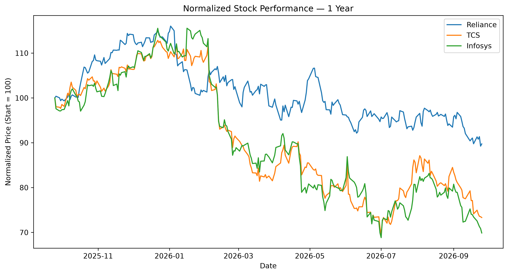
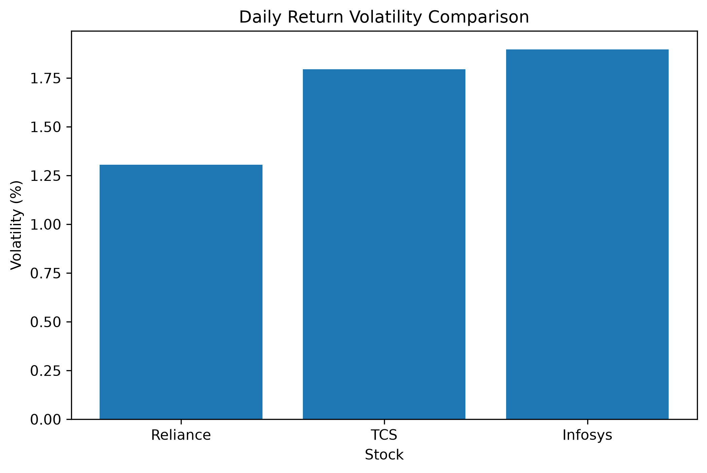
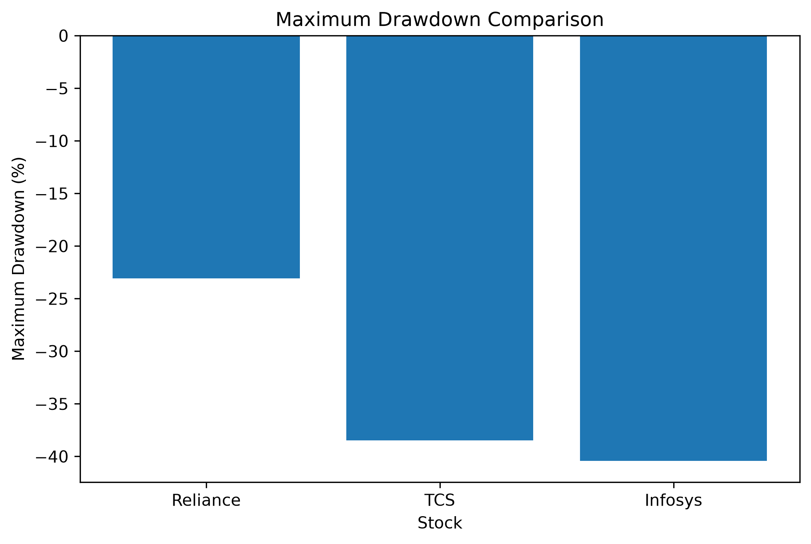

# Indian Stock Price EDA

**A quantitative exploration of return, volatility, and drawdown across three major Indian equities.**

[](https://www.python.org/)
[](https://pandas.pydata.org/)
[](https://numpy.org/)
[](https://matplotlib.org/)
[](https://jupyter.org/)

---

## Overview

This project investigates how three major Indian equities behaved over one year of daily NSE closing prices (25 Sep 2025 to 25 Sep 2026, 248 trading days):

- **Reliance Industries** — `RELIANCE.NS`
- **Tata Consultancy Services** — `TCS.NS`
- **Infosys** — `INFY.NS`

Rather than evaluating stocks using price alone, the analysis combines three dimensions:

> **Performance + Volatility + Drawdown**

This creates a more complete view of historical price behavior and demonstrates how financial metrics can be calculated, visualized, compared, and interpreted using Python.

---

## The Analytical Question

> How did the selected stocks differ in historical return behavior, daily variability, and peak-to-trough decline during the period analyzed?

To answer this, the project examines:

| Dimension            | Metric                  | What It Measures                              |
|-----------------------|-------------------------|------------------------------------------------|
| Performance           | Total Return            | Overall change in price                        |
| Daily Behavior        | Average Daily Return    | Average one-day price movement                 |
| Risk                  | Daily Volatility        | Variability of daily returns                   |
| Changing Risk         | 30-Day Rolling Volatility | How volatility changed over time             |
| Extremes              | Best / Worst Day        | Largest observed daily movements               |
| Downside              | Maximum Drawdown        | Largest decline from a previous peak           |
| Relative Performance  | Normalized Price        | Comparative movement from a common start point |

---

## Key Results

| Stock    | Total Return | Avg. Daily Return | Volatility | Best Day | Worst Day | Max Drawdown |
|----------|-------------:|-------------------:|-----------:|---------:|----------:|-------------:|
| Reliance |      -10.25% |            -0.0353% |      1.30% |   +3.53% |    -4.60% |       -23.08% |
| TCS      |      -26.68% |            -0.1094% |      1.80% |   +6.51% |    -8.39% |       -38.46% |
| Infosys  |      -30.13% |            -0.1271% |      1.90% |   +5.68% |    -7.26% |       -40.43% |

**Historical observations**

- All three stocks recorded negative price returns over the analyzed period.
- Reliance recorded the lowest observed daily-return volatility among the three, at 1.30%.
- TCS recorded both the largest single-day positive movement (+6.51%) and the largest single-day negative movement (-8.39%).
- Infosys recorded the highest daily volatility (1.90%) and the largest maximum drawdown in the sample (-40.43%).
- Return, volatility, and drawdown capture different characteristics of historical price behavior.

*These are historical observations from the selected sample and are not predictions of future performance.*

---

## Visual Analysis

### 1. Normalized Performance

All three stocks are normalized to a starting value of 100, allowing their relative price paths to be compared on the same scale.



### 2. Volatility Comparison

Volatility is calculated as the standard deviation of daily returns.



| Stock    | Daily Volatility |
|----------|------------------:|
| Reliance |             1.30% |
| TCS      |             1.80% |
| Infosys  |             1.90% |

Volatility measures variability in observed daily returns; it does not by itself indicate whether returns were positive or negative.

### 3. Maximum Drawdown

Maximum drawdown measures the largest decline from a previous peak closing price during the observation period.



| Stock    | Maximum Drawdown |
|----------|------------------:|
| Reliance |           -23.08% |
| TCS      |           -38.46% |
| Infosys  |           -40.43% |

This demonstrates why total return alone does not describe the complete path taken by a stock price.

---

## Analytical Framework

```text
Yahoo Finance Market Data
          |
          v
     Data Collection
          |
          v
     Data Inspection
          |
          v
   Daily Return Calculation
          |
          +----------------+
          |                |
          v                v
     Volatility      Rolling Volatility
          |                |
          +-------+--------+
                  |
                  v
          Drawdown Analysis
                  |
                  v
         Cross-Stock Comparison
                  |
                  v
             Visualization
                  |
                  v
         Historical Insights
```

The objective was not simply to generate charts, but to connect each visualization to a measurable financial concept.

---

## Methodology

**Daily Returns**

```text
Return_t = (Price_t / Price_(t-1)) - 1
```

Daily simple returns measure the percentage change in closing price from one trading day to the next.

**Average Daily Return**

```text
Average Daily Return = Mean(Daily Returns)
```

Summarizes the average one-day price movement during the sample.

**Historical Volatility**

```text
Volatility = Standard Deviation(Daily Returns)
```

A higher value indicates greater variability in observed daily returns.

**Rolling Volatility**

A 30-trading-day rolling standard deviation:

```text
Rolling Volatility_t = Std(Returns over previous 30 trading days)
```

Helps identify periods of relatively higher or lower observed return variability.

**Maximum Drawdown**

A running peak is calculated:

```text
Peak_t = Maximum Price observed up to time t
Drawdown_t = (Price_t - Peak_t) / Peak_t
```

The minimum drawdown represents the largest observed decline from a previous peak.

**Normalized Performance**

Each stock is normalized to a starting value of 100:

```text
Normalized Price = (Current Price / Initial Price) × 100
```

This makes the three price series directly comparable on the same scale.

---

## Project Structure

```text
Indian-StockPrice-EDA/
├── 01_stock_eda.ipynb
├── data/
│   └── prices.csv
├── outputs/
│   ├── normalized_performance.png
│   ├── volatility_comparison.png
│   ├── drawdown_comparison.png
│   └── stock_comparison.csv
├── .gitignore
├── requirements.txt
└── README.md
```

---

## Reproducibility

**Requirements**

The project uses pandas, NumPy, Matplotlib, yfinance and Jupyter. Pinned versions are listed in `requirements.txt`.

**Installation**

```bash
git clone https://github.com/Aadarsh2807/Indian-StockPrice-EDA.git
cd Indian-StockPrice-EDA
python -m venv .venv
```

On Windows:

```bash
.venv\Scripts\activate
```

Install dependencies:

```bash
pip install -r requirements.txt
```

Launch Jupyter:

```bash
jupyter notebook
```

Open `01_stock_eda.ipynb` and run the notebook cells sequentially. It reads the saved prices from `data/prices.csv`, so it reproduces the results above without an internet connection.

---

## Data Source

Daily closing prices were downloaded once with `yfinance` and saved to `data/prices.csv`, so the analysis can be rerun on exactly the same data.

NSE ticker symbols used:

```text
RELIANCE.NS
TCS.NS
INFY.NS
```

The dataset represents historical market observations available through the data provider at the time of retrieval. To download the same date range again, set `DOWNLOAD_FRESH_DATA = True` in the notebook; Yahoo Finance sometimes revises its history, so a fresh download may differ slightly from the saved file.

---

## Technologies

| Technology       | Purpose                          |
|-------------------|-----------------------------------|
| Python            | Analysis and computation          |
| Pandas            | Data manipulation                 |
| NumPy             | Numerical operations              |
| Matplotlib        | Data visualization                |
| yfinance          | Historical market-data retrieval  |
| Jupyter Notebook  | Interactive analysis              |
| Git               | Version control                   |
| GitHub            | Project publishing                |

---

## What I Learned

This project was built to develop practical financial analytics skills rather than only produce visualizations.

**Financial concepts**
- Daily returns
- Volatility
- Rolling volatility
- Drawdown
- Normalized performance
- Peak-to-trough analysis

**Data analytics**
- Retrieving market data programmatically
- Inspecting financial time-series data
- Working with time-indexed datasets
- Creating derived financial metrics
- Comparing multiple securities
- Translating numerical results into observations

**Python**
- Pandas DataFrames and Series
- Percentage-change calculations
- Rolling-window calculations
- Cumulative maximum calculations
- Matplotlib visualization
- Exporting analytical results

**Reproducibility**
- Virtual environments
- Dependency management
- Git version control
- GitHub publishing
- Reproducible notebook workflows

---

## Limitations

This project is intentionally limited in scope.

**Dataset limitations**
- One year of historical data (248 trading days) was analyzed.
- Only three equities were included.
- The analysis focuses primarily on price behavior.
- Results depend on the historical sample selected.

**Financial-model limitations**

The analysis does not include:
- Dividends
- Taxes
- Brokerage charges
- Slippage
- Transaction costs
- Fundamental company metrics
- Macroeconomic variables
- Sector-level analysis
- Portfolio optimization

Therefore, the calculated returns represent historical price movements rather than complete investor returns.

---

## Key Takeaway

A single metric does not fully describe market behavior.

```text
Return      -> What happened to the price?
Volatility  -> How much did daily returns fluctuate?
Drawdown    -> How large was the decline from a previous peak?
```

Combining these metrics provides a broader description of historical price behavior than looking at price charts alone.

---

## Future Extensions

Potential extensions include:

- NIFTY 50 benchmark comparison
- Sector-level comparison
- Sharpe ratio
- Beta estimation
- Correlation analysis
- Rolling correlation
- Value-at-Risk analysis
- Longer historical periods
- Portfolio-level analysis
- Interactive financial dashboards

These extensions would build on the current analytical foundation and introduce additional quantitative-finance concepts.

---

## Disclaimer

This project is intended for educational and portfolio-development purposes only.

The analysis describes historical market behavior and does not constitute investment advice, financial advice, or a recommendation to buy or sell any security.

**Past performance does not guarantee future results.**
